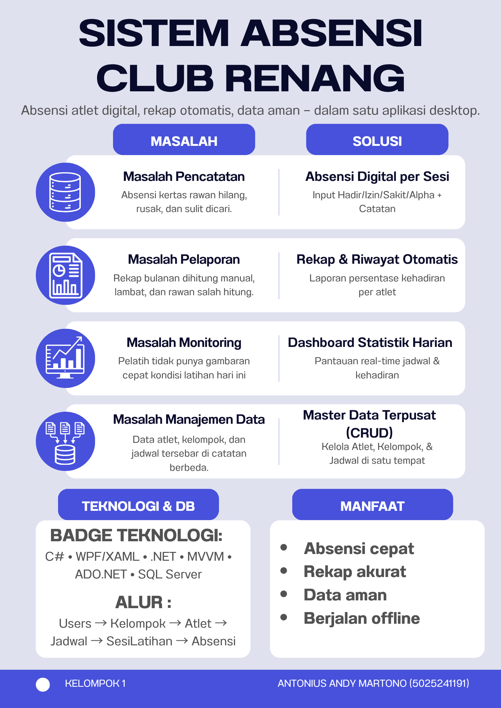

# JAWABAN TUGAS MINGGU KE-7 — PBKK
## Kelompok 1
| Nama | NIM |
|---|---|
| Antonius Andy Martono | 5025241191 |
| Sinurat Federico | 5025241244 |

**Aplikasi:** SACR — Sistem Absensi Club Renang
**Teknologi:** C#, WPF (XAML), .NET, SQL Server, ADO.NET, MVVM

---

## SOAL 1 — Perbedaan Aplikasi Desktop dengan Aplikasi Lain, dan Mengapa Masih Dibutuhkan

### 1.1 Pengertian
Aplikasi desktop adalah perangkat lunak yang **diinstal dan dijalankan langsung di sistem operasi komputer** (misalnya Windows) tanpa wajib bergantung pada browser atau server jarak jauh. Aplikasi kami, **SACR (Sistem Absensi Club Renang)**, dibangun sebagai aplikasi desktop menggunakan **WPF (Windows Presentation Foundation)** dengan database **SQL Server** yang berjalan lokal.

### 1.2 Perbedaan dengan Jenis Aplikasi Lain

| Aspek | Aplikasi Desktop | Aplikasi Web | Aplikasi Mobile |
|---|---|---|---|
| Tempat berjalan | Langsung di OS komputer (Windows/macOS/Linux) | Di browser, logika utama di server web | Di smartphone/tablet (Android/iOS) |
| Instalasi | Installer (.exe/.msi), tersimpan di mesin | Tidak perlu instalasi, cukup URL | Via app store (Play Store/App Store) |
| Kebutuhan internet | **Tidak wajib** — dapat bekerja offline penuh | **Wajib** untuk hampir semua operasi | Umumnya wajib, sebagian mendukung offline |
| Performa | **Paling tinggi** — akses penuh CPU/RAM/disk lokal | Terbatas latensi jaringan & kemampuan browser | Terbatas daya baterai & resource perangkat |
| Akses hardware/OS | Penuh (file system, printer, perangkat lokal, database lokal) | Terbatas sandbox browser | Terbatas izin sensor/perangkat mobile |
| Penyimpanan data | Dapat memakai database lokal (SQL Server/LocalDB) | Di server pusat/cloud | Di penyimpanan perangkat + sinkronisasi |
| Karakter UI | Rich UI: DataGrid besar, form padat, shortcut keyboard — cocok untuk kerja operasional panjang | UI responsif umum, cocok dokumen & informasi | UI sentuh, layar kecil, sesi penggunaan singkat |
| Distribusi & update | Manual per mesin (kontrol penuh) | Terpusat (paling mudah update) | Melalui app store (proses review) |

### 1.3 Mengapa Aplikasi Desktop Masih Dibutuhkan?
1. **Performa dan responsivitas tinggi.** Operasi berat (tabel data besar, transaksi penyimpanan massal) diproses lokal tanpa latensi jaringan. Pada SACR, penyimpanan absensi satu sesi untuk seluruh atlet dilakukan dalam satu transaksi database lokal yang cepat.
2. **Dapat bekerja offline.** Banyak lokasi operasional (seperti kolam renang/sekretariat club) tidak memiliki internet stabil. Aplikasi desktop tetap berfungsi penuh karena database berada di mesin yang sama.
3. **Keamanan dan kendali data.** Data sensitif (akun, kehadiran atlet) disimpan di database lokal milik organisasi, bukan di server pihak ketiga. Password disimpan sebagai hash SHA-256 dan seluruh query berparameter.
4. **Rich UI untuk pekerjaan administratif.** Pekerjaan input data intensif (CRUD atlet, pengisian absensi per baris, filter, pencarian) jauh lebih efisien dengan DataGrid, form, dan shortcut keyboard khas desktop dibanding UI web/mobile.
5. **Integrasi mendalam dengan OS dan perangkat lokal.** File, printer, notifikasi Windows, dan instance SQL Server lokal dapat diakses langsung tanpa perantara.
6. **Independensi biaya infrastruktur.** Tidak membutuhkan hosting, domain, atau langganan cloud; cocok untuk organisasi kecil seperti club renang.
7. **Stabilitas untuk pemakaian panjang.** Aplikasi operasional yang dinyalakan berjam-jam setiap hari lebih andal berjalan sebagai proses lokal dibanding sesi browser yang rentan tab tertutup/timeout.

**Kesimpulan:** aplikasi desktop tetap relevan karena unggul pada performa, kemampuan offline, kendali data, dan kenyamanan kerja operasional — karakteristik yang justru menjadi kebutuhan utama sistem absensi club renang seperti SACR.

---

## SOAL 2 — Problem yang Diselesaikan Aplikasi dan Fitur Solusinya

### 2.1 Problem yang Diselesaikan
SACR dibangun untuk menyelesaikan permasalahan operasional club renang berikut:

1. **Absensi masih manual (kertas).** Catatan rawan hilang, rusak, terselip, dan sulit dicari kembali.
2. **Rekap kehadiran lambat dan rawan salah.** Menghitung jumlah hadir/izin/sakit/alpha serta persentase per atlet secara manual memakan waktu setiap bulan.
3. **Tidak ada gambaran harian bagi pelatih.** Pelatih tidak tahu secara cepat berapa atlet yang hadir/tidak hadir pada latihan hari ini.
4. **Data atlet, kelompok, dan jadwal tersebar.** Pembaruan data dilakukan di catatan terpisah sehingga tidak sinkron.
5. **Riwayat kehadiran sulit ditelusuri.** Tidak ada cara cepat melihat perjalanan kehadiran satu atlet beserta alasannya (catatan izin/sakit).
6. **Risiko data tidak valid.** Absensi ganda untuk sesi yang sama atau input jam jadwal yang tidak masuk akal.
7. **Keamanan data lemah.** Password plaintext dan query yang rentan injeksi SQL bila dibangun tanpa standar.
8. **Error teknis menghentikan pekerjaan.** Aplikasi sejenis sering menutup paksa saat database bermasalah.

### 2.2 Definisi Fitur sebagai Solusi

| No | Problem | Fitur Solusi | Cara Fitur Bekerja |
|---|---|---|---|
| 1 | Absensi kertas rawan hilang | **Absensi Digital per Sesi** | Pelatih memilih jadwal + tanggal; sistem membuat SesiLatihan otomatis dan menampilkan seluruh atlet aktif kelompok tersebut untuk diisi statusnya. |
| 2 | Rekap manual lambat/salah | **Rekap Bulanan Otomatis** | Query agregat SQL (SUM/CASE) menghitung Hadir, Izin, Sakit, Alpha, dan persentase kehadiran per atlet untuk bulan/tahun/kelompok terpilih. |
| 3 | Tidak ada gambaran harian | **Dashboard Statistik** | Empat kartu (Total Atlet Aktif, Latihan Hari Ini, Hadir Hari Ini, Tidak Hadir Hari Ini) + daftar Jadwal Hari Ini dengan tombol pintas **Isi Absensi**; seluruh angka hasil query database. |
| 4 | Data tersebar tidak sinkron | **Master Data Terpusat (CRUD)** | Halaman Atlet, Kelompok, dan Jadwal dengan tambah/ubah/hapus, pencarian nama, filter kelompok & status, validasi form, dan konfirmasi hapus. |
| 5 | Riwayat sulit ditelusuri | **Riwayat Absensi Atlet** | Filter atlet/bulan/tahun menampilkan ringkasan (jumlah kehadiran & persentase) plus tabel riwayat per tanggal lengkap dengan jam latihan, status, dan catatan. |
| 6 | Data tidak valid | **Validasi & Constraint Database** | Status terbatas Hadir/Izin/Sakit/Alpha (check constraint); satu atlet maksimal satu absensi per sesi (unique constraint); jam selesai wajib setelah jam mulai; penyimpanan absensi memakai transaksi (rollback bila gagal). |
| 7 | Keamanan lemah | **Login Ber-hash & Parameterized Query** | Password disimpan sebagai hash SHA-256 (VARBINARY(64)), diverifikasi saat login; seluruh operasi database memakai parameter (`@Nama`, `@Id`, dst.) sehingga tahan SQL injection. |
| 8 | Error menghentikan pekerjaan | **Penanganan Error & Notifikasi** | Kegagalan koneksi memunculkan pesan ramah tanpa crash; setiap operasi CRUD/absensi memberi notifikasi berhasil/gagal; empty state ditampilkan bila data kosong. |

### 2.3 Kesimpulan
SACR mengubah proses absensi club renang dari **manual-tersebar-rawan salah** menjadi **digital-terpusat-tervalidasi**: satu aplikasi desktop untuk mencatat kehadiran per sesi, mengelola data master, dan menghasilkan rekap serta riwayat secara otomatis dari database.

## SOAL 3 — Buat Poster Infografis aplikasi yang telah dibuat dalam 1 halaman.

